# このサイトができるまで ―― AIと一緒に、昆布観測島の特設サイトを作った話

**書いた人：アブディラー リョウ**

> **【リード文】**
> 今年のMIF特設サイトは、8割をAIが書いている。けれど、フォントを選び、レイアウトを直し、足しすぎたものを消していったのは人間だった。コンピュータ部補佐のアブディラーが、このサイトができるまでをふり返る。

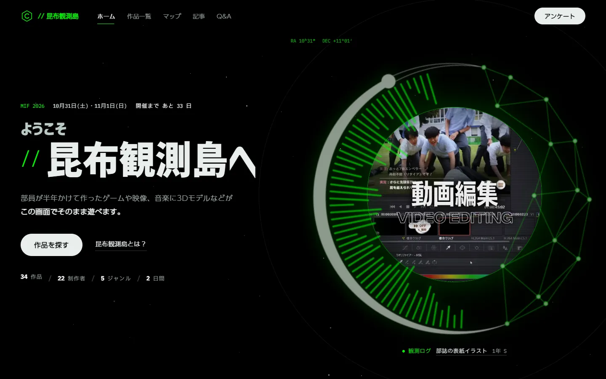
*いまのホーム。部のロゴを望遠鏡の縁に見立てた「観測窓」*

> **【プロフィール】アブディラー リョウ**
> （所属：コンピュータ部 補佐）
> - 中学　コンピュータ部の中学部長を務める
> - 高校　コンピュータ部の補佐になる
> - 2026年8月　MIF特設サイトを作り始める
> - 2026年10月　MIFで特設サイトを公開

---

## ① はじめに

*このサイトを、いったい誰が、どうやって作ったのか。*

こんにちは。能代先輩の記事ではインタビュアーを務めた、アブディラー リョウです。コンピュータ部の補佐という役割で、これまで昆布を支えてきました。今回のMIFでは、主にこのページ、つまりこの特設サイトの制作に力を入れました。

といっても、完全に僕が作ったわけではありません。8割は、なんとAIが作っています。いったいどうやって作ったのか、気になりませんか？ この記事では、僕がこのサイトを完成させるまでの流れを、順番に話していきます。

その前に、少しだけ「サイトってそもそも何？」という話をさせてください。サイトは、URLさえ知っていれば、世界中のどこからでも見られる場所です。ただ、見に来た人にいつでもページのデータを送れるようにしておかないといけません。自分のPCに置いておくと、電源を切った瞬間に誰も見られなくなってしまいます。そこでページのデータは、いつも動き続けているクラウド上のサーバーに置くのが一般的です。

今回、そのサーバーの役目をしてくれているのがGitHubです。GitHubは、プログラムの変更・保存・管理をみんなで一緒にできる、世界最大の開発プラットフォームで、全世界のプログラマーがこぞって使っています。そのGitHubにサイトのデータを保存し、GitHub Pagesという機能で、誰でも見られるサイトとして公開しています。

> **【注釈】GitHub Pages（ギットハブ ページズ）**
> GitHubに置いたファイルを、そのままWebサイトとして公開できる機能。サーバーを自分で用意しなくても、無料でサイトを公開できる。

専門的な話はここまで！ ここからは、そもそもなぜAIでサイトを作ろうと思ったのか、というところから始めます。話は、去年の昆布のサイトにさかのぼります。

---

## ② きっかけは、去年のサイト

*とっつきにくいサイトを、華やかにしたかった。*

これまでの昆布のサイトは、正直、とっつきにくい無機質なサイトでした。

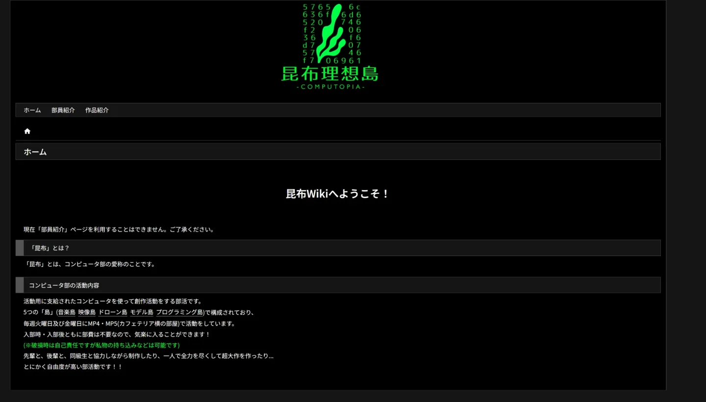
*去年までの昆布のサイト*

時間がなかったのも理由の一つですが、やはり部員のプログラミングの力だけで作るには限界があります。もっと作品に華を持たせたいのに、見た目のせいで敬遠されてしまう部分もありました。（とはいえ、これをAIなしで一人で作った先輩には、本当に憧れます）

それなら、もっとAIを活用してもいいんじゃないか？ と思いました。AIは本当にすごいです。少ない時間で大量のコードを書き、直し、良くしていく。この圧倒的な速さで「作って、試して、直す」を回す力には、どんな人間も追いつけないでしょう。

ただ、ひとつ引っかかることがありました。世の中では、AIによるクリエイティブな活動はなかなか受け入れられていません。AIの作るものは画一的で、人間の温かみを感じられないから、という意見です。僕も、温かみを感じないサイトなら作る必要はないと思います。

でも、それは本当にAIを使わない理由になるでしょうか？ 僕がこのサイトに温かみを感じるのは、見た目のおかげではありません。作品にオリジナリティがあって、部員一人ひとりの人生にストーリーがあるからです。この二つの深みがあれば、たとえAIでサイトを作ったとしても、人間の温かみは共存できるし、むしろ相乗効果が生まれる。そう考えて、AIで作ることに決めました。

> **【引用】**
> この二つの深みがあれば、たとえAIでサイトを作ったとしても、人間の温かみは共存できるし、むしろ相乗効果が生まれる。

ちなみに、このサイト作りは誰かに頼まれたわけではありません。僕はもともと中学の部長で、高校に上がったタイミングでコンピュータ部の補佐を任されました。高校生の部員は本当に人が足りず、部長・副部長もほかの部活と兼任していることが多いので、中学で部長の経験がある僕が支える役になったんです。
そんな中で、「昆布のMIF特設サイトは、もっと華やかにできる！」と信じて勝手に作り始めたら、話の流れでなんか採用されていました。

こうして8月、サイト作りが始まりました。

---

## ③ AIに、デザインをどう伝えるか

*文字だけではデザインは伝わらない。だから、絵で伝えた。*

最初にAIが作ったサイトを見たときは、案外アリだと思いました。というより、あまり絶望しなかった。サイトのデザインは壁打ちしてなんぼなので、ここから直していけばいいと思ったんです。

ただ、直していくうちに壁にぶつかりました。「こういう見た目にしたい」を、文字だけでAIに伝えるのがすごく難しいんです。

そこで使ったのが、「別のAIを活用する」というコツです。デザインはChatGPTに任せて、画像生成で「完成したサイトの絵」をたくさん作ってもらいました。絵があれば、それを見せて「これを作って」と頼めます。

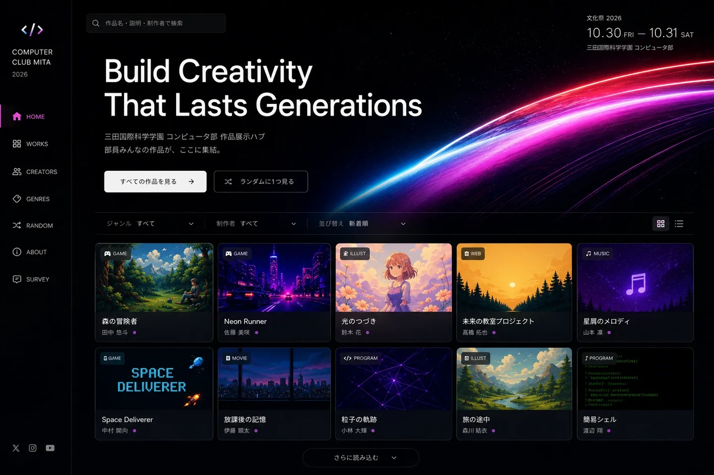
*画像生成で作ってもらった、最初のデザイン案*

ところが、これはあまり良い結果になりませんでした。動画編集やデザインに触れてきた僕から見ると、こういうサイトはどうしても量産型に見えたんです。特に、画面の下にずらりと並んだ作品のパネル。無機質に詰め込まれた、ペットショップのケージのような不安感があります。実際、この方向で作った最初の版も、同じような見た目でした。

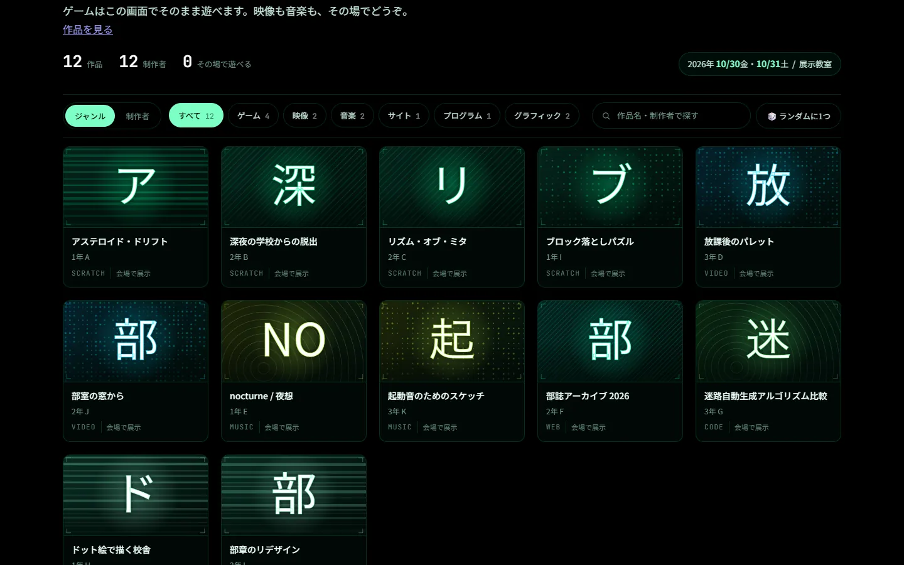
*8月19日、いちばん最初の版。作品が同じ形のカードに詰め込まれている*

これではオリジナリティがない。そこで、MIFのテーマである「eclipse（食）」と、昆布のカラーであるネオングリーンを組み合わせたデザインに切り替えました。

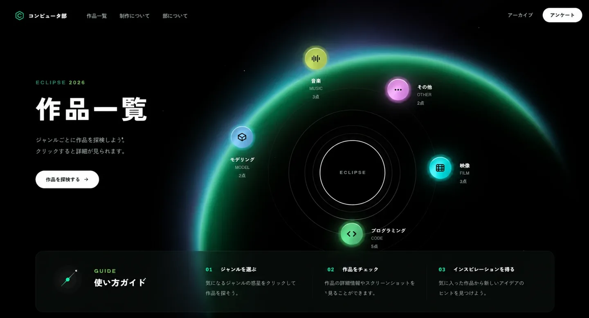
*eclipseとネオングリーンで作り直したデザイン案。ジャンルが惑星のように回る*

この絵をもとに、AIにどんどんプロンプトを投げていきました。8月20日にはデザインの形がまとまり、22日には実際に動くサイトになりました。

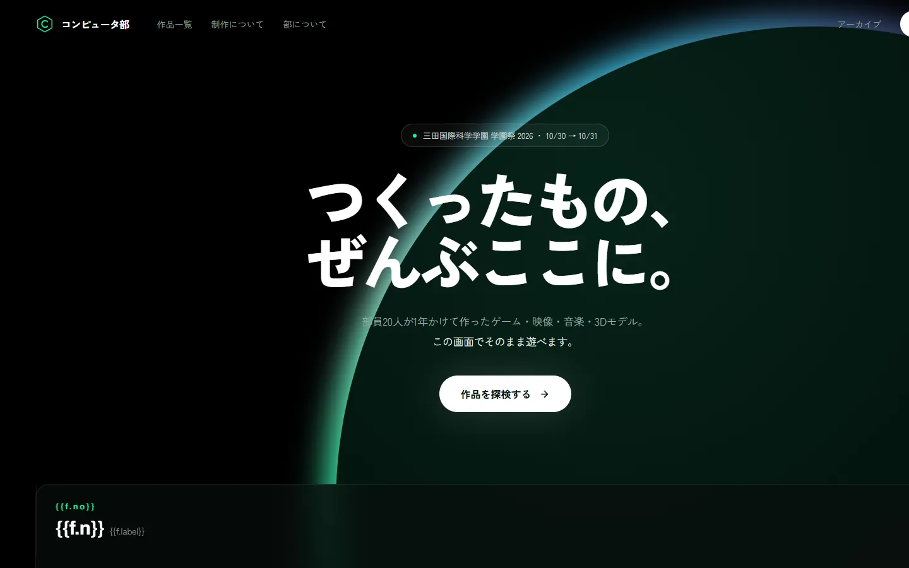 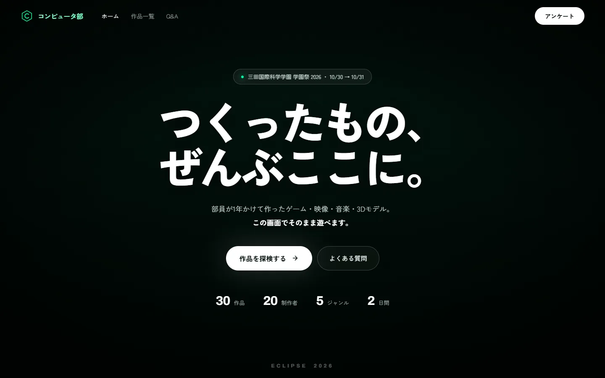
*左：8月20日のデザイン案　右：8月22日、最初に動いた版*

そこからは、少しずつ足しては直す日々です。初めて開いた人を迎える「ようこそ」画面を作り、会場の3Dマップを作り、そのマップを教室の実際の寸法どおりの模型に作り直しました。

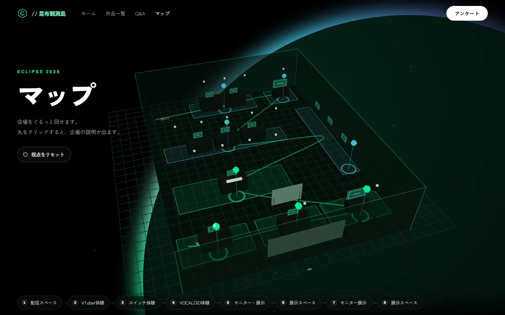 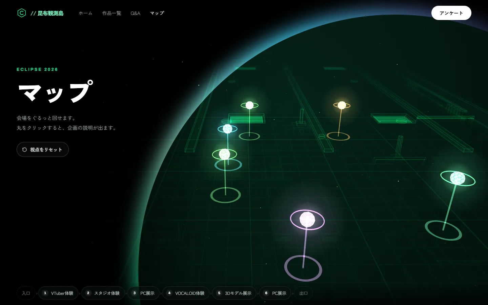
*会場マップ。左：8月25日の最初の版　右：9月10日、教室を寸法どおりに作り直した版*

こうして機能がそろってくると、今度は「なんだか使いにくい」「なんだか安っぽい」という細かい所が気になり始めました。ここからが、人間の出番です。

---

## ④ レイアウトとフォントは、人間が決める

*AIは演出が一流。でも、心地よいリズムと文字選びは人間の仕事。*

AIは演出面では一流です。アニメーションも、コーディングも。でも、その演出の一つであるレイアウトだけは、なぜかうまくいかないんです。人間が心地よく感じるリズムがないというか、とにかく直感的に操作できない。だから、ボタンの配置や余白の使い方は、かなりこちらから直しました。ホームも、この段階で大きく作り直しています。

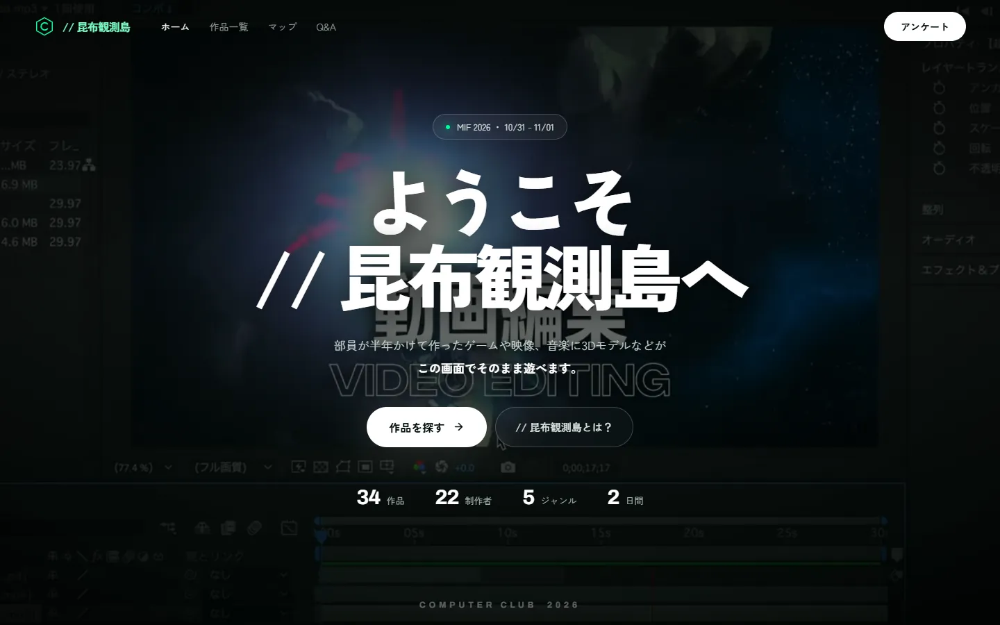 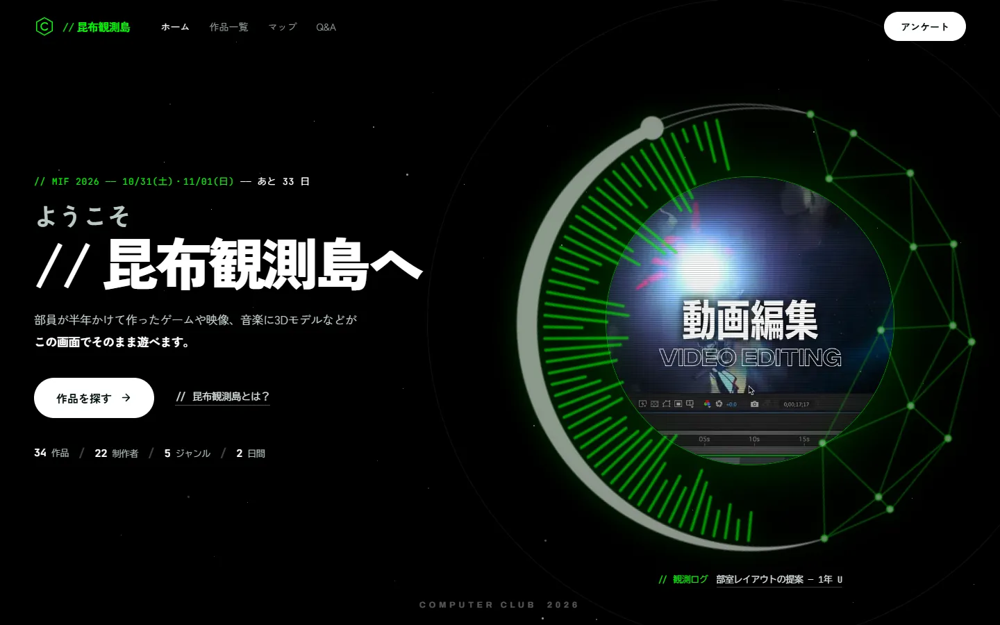
*ホーム。左：9月11日　右：9月23日、部のロゴを望遠鏡の縁に見立てた「観測窓」に*

そして、レイアウト以上にこだわったのがフォントです。

実は最初、見出しには明朝体が使われていました。それを見て「何か違う」と思ったとき、思い出したのがこのツイートです。

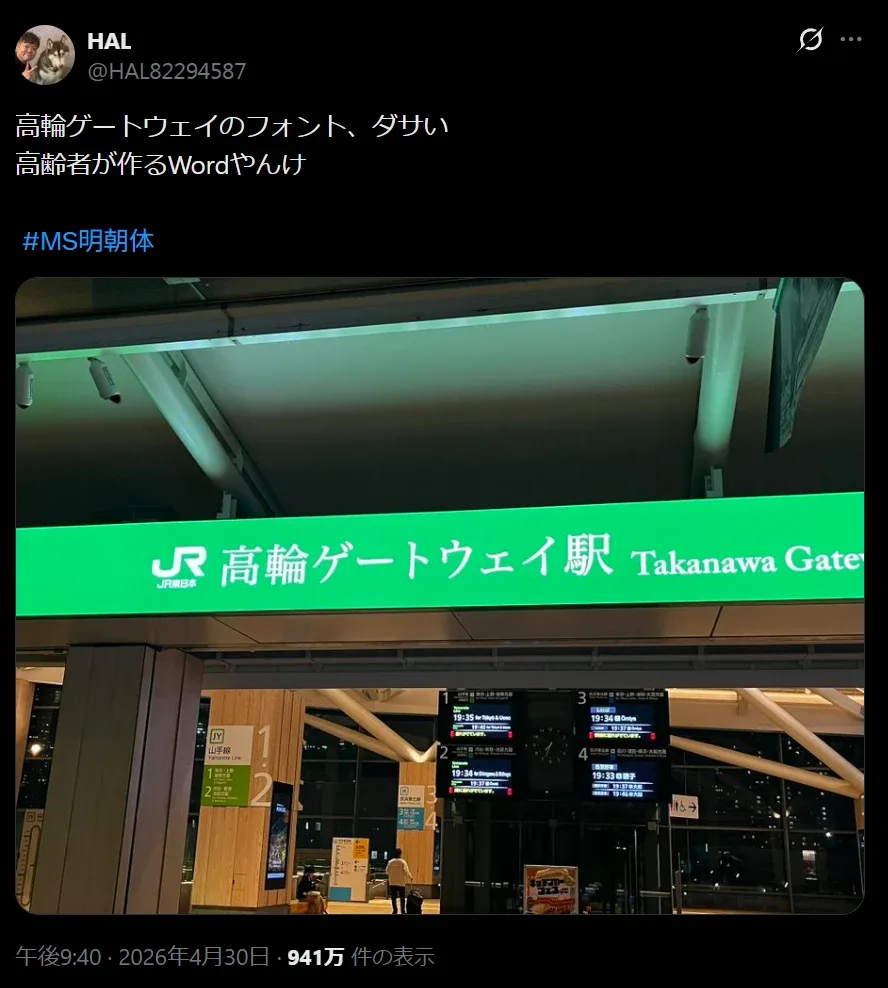
*高輪ゲートウェイ駅の駅名標が明朝体で話題になったときのツイート*

明朝体は長い文章を読むのには向いていますが、駅の看板やタイトルのように、何かを象徴的に見せる文字には向いていません。線が細いぶん存在感がなく、弱く見えてしまうんです。このツイートを見て初めて、日本語のWebサイトでは、見出しに明朝体を使うところが意外と少ないことに気づきました。明朝体って、なぜかおじさん感が否めないんですよね。

そこで見出しは、いくつかの候補を実際のページに当てて比べてから決めました。

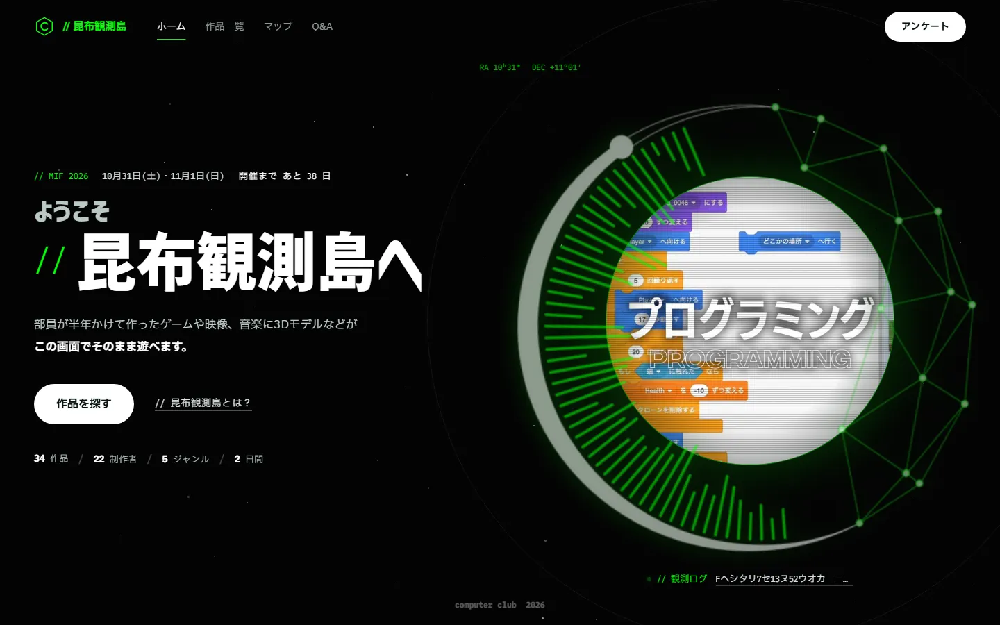 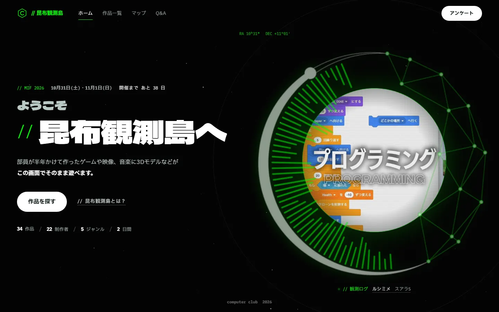 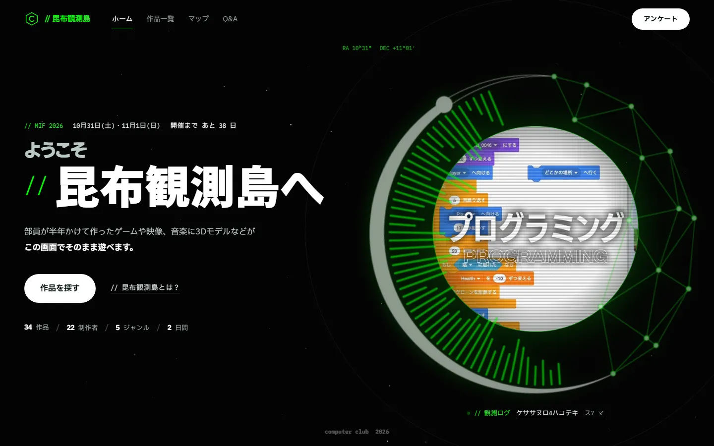
*見出しの候補。左からコーポレート・ロゴ、Dela Gothic One、源暎ぬーゴシック。一番左に決めた*

見出しが決まると、今度は本文の字が気になり始めました。個人的には、前のフォントの「い」がすごく気持ち悪く感じたのを覚えています。まるで中国語のフォントを無理やり日本語に対応させたみたいで、心地よい止め・はね・はらいではありませんでした。

そこで本文はUD新ゴに変えました。UDというフォントスタイルをご存じですか？UDはUniversal Designの略で、誰が見ても、どこから見ても読みやすいように工夫されたフォントのことです。UD新ゴは読みやすいだけでなく、横につぶしたような形をしていて、単純な正方形のフォントとは違うスタイリッシュさがあります。これがコンピュータ部のデジタルチックな雰囲気と完璧に合っていると思いました。

> **【注釈】UDフォント（ユニバーサルデザインフォント）**
> 年齢や視力にかかわらず、誰にとっても読みやすく、読み間違えにくいように設計されたフォント。濁点がつぶれにくい、似た字の形がはっきり違う、などの工夫がある。

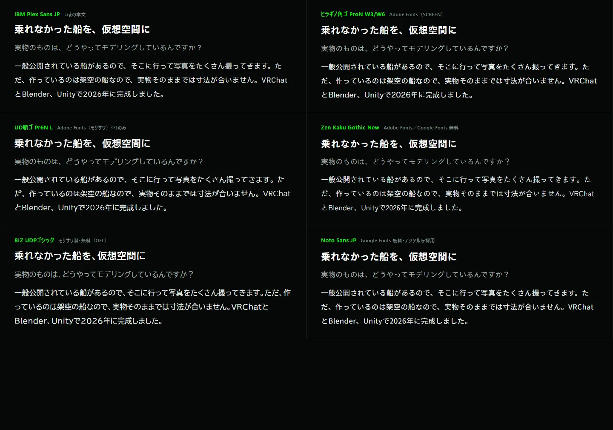
*本文の候補を、記事の実際の文章で並べて比べた*

フォントが変わると、一気に会社のホームページのような高級感が出て、かなり嬉しかったです。フォントは日本語サイトにおける重要な要素だと、あらためて実感しました。

ただ、フォント選びには落とし穴もありました。PCに入っていても、「商用利用可」と書いてあっても、そのままサイトに置けるとは限らないんです。

> **【注釈】フォントのライセンス**
> サイトにフォントを置くと、見に来た人のブラウザにフォントのファイルそのものが配られる。これが「再配布（二次配布）」にあたるため、無料フォントや購入したフォントでも、Webには置けないことがある。SIL Open Font License（OFL）のフォントや、Adobe Fontsの「Webプロジェクト」のように、Webでの利用を認めている方法なら使える。

サイトはたくさん作ってきましたが、公開したことはありませんでした。だから、こういうケースでも二次配布になるとは初めて知りました。フォントは買って終わりではなく、その先のライセンスは含まれていない。そう考えると、なんだかちょっとケチくさく思ってしまいました（←炎上）。結局UD新ゴは、Adobe FontsのWebプロジェクトという正式な方法で読み込んでいます。

---

## ⑤ AIは足し算が得意で、引き算が苦手

*光を消し、枠を消し、ラベルを消した。*

レイアウトとフォントが整っても、まだ何かが「AIっぽい」。その正体に気づいたのは、画面を眺めていて、やたら情報量が多いと感じたときでした。

AIは足し算が得意で、引き算が苦手なんです。何でもかんでも追加しようとして、結局ごちゃついてしまう。光る装飾、囲み枠、見出しの上の英語のラベル……どれも一つずつは格好いいのに、全部あると落ち着きません。

> **【引用】**
> AIは足し算が得意で、引き算が苦手。

そこで、AIっぽく見える原因を調べてリストにし、それをもとにサイト全体を点検しました。光る装飾は17か所から2か所に、角の丸みの種類は7種類から1種類に、見出しの上の英語のラベルは9種類から、記事の種類と番号を示す最小限だけに減らしました。

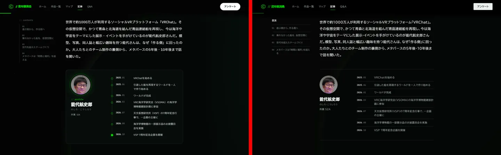
*左が直す前、右が直した後。光る縁と、囲む枠を消した*

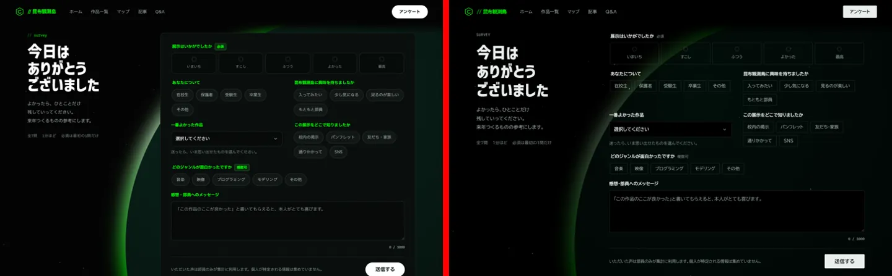
*アンケートも。左が前、右が後*

結果は最高でした。情報量を減らすと、人間はこんなにも目の前のことに集中できるのか、と。ただしボタンだけは丸くしました。月食って丸いから、サイトの雰囲気も丸っぽくしたかった。それだけです。

この「点検のやり方」は、一度きりで終わらせずに、「skill」としてAIに覚えさせました。skillは、細かく書いた作業の手順を登録しておいて、「/」で呼び出せるコマンドのようなものです。たとえば、名前と年齢を分けてスプレッドシートに入れる作業を、毎回プロンプトとして書くのは大変ですよね。それを「/split-status」というskillにしておけば、毎回書かなくて済みます。Scratchでいう「ブロック定義」みたいなものです。

> **【注釈】skill（スキル）**
> AIに、作業の手順や知識をまとめて覚えさせておく仕組み。今回作ったのは、日本語サイトの「AIっぽさ」を見つける30のチェック項目と、日本語の文字組み（文字の大きさ・行と行の間・文字と文字の間）の目安、フォントのライセンスの扱いをまとめたもの。

skillにして良かったのは、普通のAIには備わっていない、自分専用のデザインAIができあがったことです。簡単にデザインを直せるようになって、ストレスがたまることがなくなりました。

---

## ⑥ 辛口はいい、悪口はだめ

*見た目の次は、中身。来場者の「ひとこと」をどう扱うか。*

見た目が整ったところで、もう一つ大事な仕組みがあります。作品に「ひとこと」を書き込める機能です。誰でも書けるということは、ひどい言葉が書かれる可能性もある。そこで、AIが審査してから載せる仕組みにしました。

一番悩んだのは、どこまで載せるかです。正直、コンピュータ部はぬるま湯につかっていると僕は思います。大会に出ることもないし、ずっとPCを触って何かしているだけで、外で戦うことは基本しません。でも、だからこそ、文化祭のような場ではフィードバックが大事です。多少辛口でも、作った人がしっかり直していける機会になるなら、載せるべきだと思いました。

悪口はその逆です。直す機会を与えるどころか、直す機会を潰しているだけ。どこからが辛口で、どこからが悪口なのかの判断は難しいですが、なるべく改善の余地がある意見は残すよう、JevというAIに伝えてあります。

> **【引用】**
> 悪口は、直す機会を与えるどころか、直す機会を潰しているだけ。

> **【注釈】Jev（ジェブ）**
> TypeSafeという会社のAI。文章を書くのではなく、決められた問いに「どれか」「何％か」で答えるのが得意。このサイトでは、ひとことを「称賛・指摘・質問・侮辱・宣伝・有害」のどれかに分け、人への侮辱や不適切な内容だと判断したものは載せない。

ちなみに、Jevが有料だと分かったときは終わったと思いました。でも料金を見たら馬鹿みたいに安かったので、すぐに課金しました。Pay to Win。

---

## ⑦ 作って、消して、隠したもの

*面白くなければ消す。守れないなら、いったん閉じる。*

足すばかりではありません。作ったのに消した機能もあります。来た人がチョークで絵を描いて、黒板に貼っていける「みんなの黒板」です。

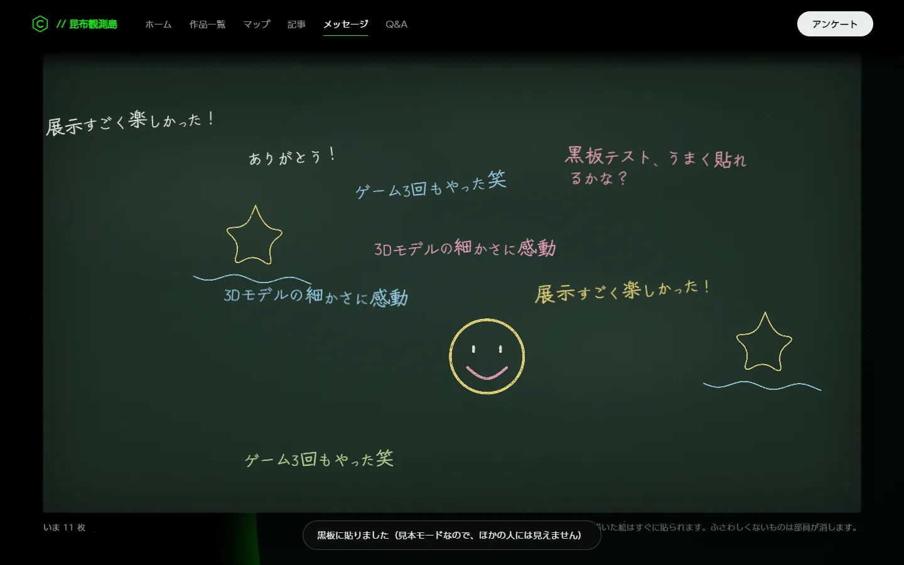
*作ったけれど、公開前に消した「みんなの黒板」*

消した理由は単純で、面白くなかったから。わざわざ来場者のために残しておく意味を、さほど感じられませんでした。ここでも、⑤の「引き算」と同じ判断をしたわけです。

それから、このサイトは一度、非公開にしています。これは今の段階の話で、これからちゃんと公開します。その時点では、サイトに載っている人たちから、まだ許可を取りきれていなかったんです。どこかに魚拓（ページの写し）を取られて、取り返しがつかなくなる前に、いったん閉じておこうと思いました。

---

## ⑧ おわりに

*8割をAIが書いたサイトを、触ってみてほしい。*

こうしてふり返ると、AIがやってくれたのは「作る」ことで、僕がやったのは「選ぶ」ことと「消す」ことだった気がします。

このサイトで一番見てほしいのは、AIが今の時点でどれほど進化しているのか、です。8割をAIが書いたこのサイトを、ぜひじっくり触ってみてください。

最後に、これからAIでものを作ってみたい人へ。Claude Codeがおすすめです。
