# メタバースで「時間と場所」を超える ―― VRChatワールド制作者・能代航史郎さんインタビュー

**聞き手：アブディラー ／ 話し手：能代航史郎**

> **【リード文】**
> 世界で約1000万人が利用するソーシャルVRプラットフォーム「VRChat」。その仮想空間で、かつて青森と北海道を結んだ青函連絡船を再現し、今は海洋や宇宙をテーマにした展示・イベントを手がけているのが能代航史郎さんだ。模型、写真、同人誌と幅広い趣味を持つ能代さんは、なぜ「作る側」に回ったのか。大人たちとのチーム制作の裏側から、メタバースの5年後・10年後まで話を聞いた。

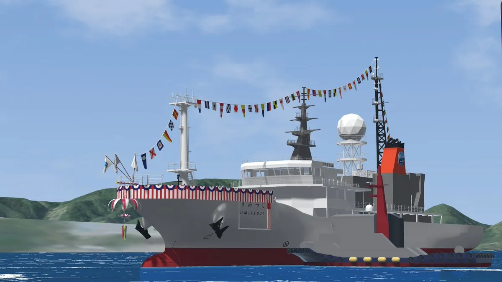
*VRC海洋学研究会（VSOMA）が建造中の海洋観測船。能代さんも制作に参加している*

> **【プロフィール】能代航史郎（のしろ・こうしろう）**
> （所属：S2A）
> - 2025年1月　VRChatを始める
> - 2025年6月　引退した船を再現するワールドを一人で作り始める
> - 2026年1月　ワールドが完成
> - 2026年3月　VRC海洋学研究会（VSOMA）の海洋学博物館建設計画に参加
> - 2026年7月　天文仮想研究所（VSP）の7周年記念行事で、一企画の主催に
> - 2026年8月　海洋学博物館の一部展示品のお披露目会を実施
> - 2026年10月　VSP 7周年記念企画を開催

---

## ① 遊ぶ側から、作る側へ

*もとは友人に誘われて始めたVRChat。1年後、能代さんは「遊ぶ側」から「作る側」に回ります。*

**アブディラー：** 能代さん、今日はよろしくお願いします。

**能代：** よろしくお願いします。

**アブディラー：** まずは、能代さんが普段どんな活動をしているのか教えてください。

**能代：** 一言で言うと、メタバースを使って、時間や場所を超えて展示やイベントを行うことをテーマに活動しています。

**アブディラー：** メタバースといってもいろいろありますが、PCやスマホで入るものですか？

**能代：** 基本的にはPCです。プラットフォームとしては「VRChat」を使っています。世界で約1000万人、日本でも約270万人が利用していて、企業や映画とのコラボも行われているプラットフォームです。

**アブディラー：** そんなにいるんですね。今のメタバースってそこまで人口が多いとは。

> **【注釈】VRChat（ブイアールチャット）**
> アバターの姿で仮想空間（ワールド）に入り、ほかのユーザーと交流できるソーシャルVRプラットフォーム。VRゴーグルがなくても、PCのデスクトップ画面から参加できる。ユーザー自身がワールドやアバターを作って公開できるのが特徴。

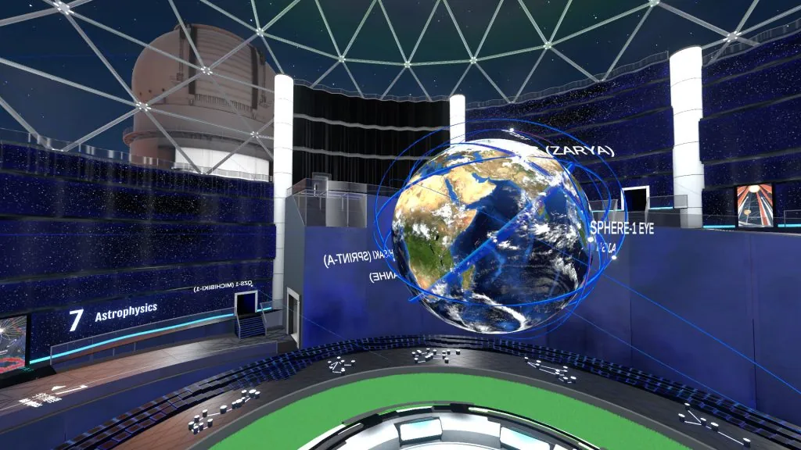
*VRChat内のワールドの例*

**アブディラー：** VRChatを始めたきっかけは何だったんでしょうか。

**能代：** 実は、今インタビューしてくれているアブディラー君のすすめなんです。

**アブディラー：** そうなんですよね。僕がVRChatにハマったのは配信者の影響なんですが、そこから僕、能代さん、そしてさらに新しい人へとどんどん広まっていくのは感慨深いです。
ただ、僕は基本的に遊ぶ側で、作る側ではないんです。能代さんは今ワールドを作っていますよね。作る側になろうと思ったのはいつ頃ですか？

> **【注釈】スタンミさんの VRChat 配信**
> アブディラーが VRChat を知ったきっかけになった、配信者・スタンミさんの動画。この動画が爆発的にバズり、それまで VR にまったく興味のなかった一般の人たちにまで、VRChat が一気に知られるきっかけになった。スタンミさんはその後も、定期的に VRChat の配信を続けている。

@[youtube](https://youtu.be/J4zY0IxCyA4)
*スタンミ「VRChatで偶然出会った謎の生命体に、腹筋を壊されるスタンミじゃぱん【VRChat】」（YouTube）*

**能代：** 最初の1年くらいは、僕もただ遊ぶだけでした。もともと趣味で模型を作ったり、船や飛行機の写真を撮ったり、同人誌を執筆したりしていて、その人間関係の中にVRChatでワールドを作っている方がいたんです。その方を見て「VRChatでものを作って発表することができるんだ」と感じて、始めました。

**アブディラー：** さらっと言いましたけど、同人誌を作っているということは、販売の経験もあるんですか？

**能代：** はい。コミックマーケットなどに出ています。

**アブディラー：** VRChat以外でも、いろいろな活動をしているんですね。

---

## ② 乗れなかった船を、仮想空間に

*初めて一人で作ったワールドは、自分が乗ることのできなかった船。その作品が、新しいプロジェクトへの入口になりました。*

**アブディラー：** では、ワールド制作について深掘りさせてください。今はどんなワールドを作っているんですか？

**能代：** 今は外部の団体の方と一緒に、「海洋」をテーマにしたワールドを作っています。日本は海に囲まれていますが、海洋について知る機会はなかなかありません。

**アブディラー：** 島国ではあるけれど、身近なのはお寿司くらいで、海そのものについてはあまり知らないですよね。とてもいいテーマだと思います。そのプロジェクトに参加したのはなぜですか？

**能代：** 海洋のワールドの前に、一人で作ったワールドがあったんです。青森と北海道を結んでいた「青函連絡船」の船内を再現したワールドです。
作ったきっかけは、まず僕自身がその船が好きだったこと。そして、話には聞いていたものの、乗る前に廃止されてしまったので、憧れがあったこと。その二つが合わさって作り始めました。
完成したワールドを、先ほど話した知り合いの方に見せたところ、「ちょうど自分たちも船を作っているから、プロジェクトに参加してくれないか」と声をかけていただいて、今に至ります。

> **【注釈】青函連絡船**
> 青森港と函館港を結んでいた鉄道連絡船。1908年から約80年にわたり本州と北海道をつないだが、青函トンネルの開業に伴い1988年に廃止された。

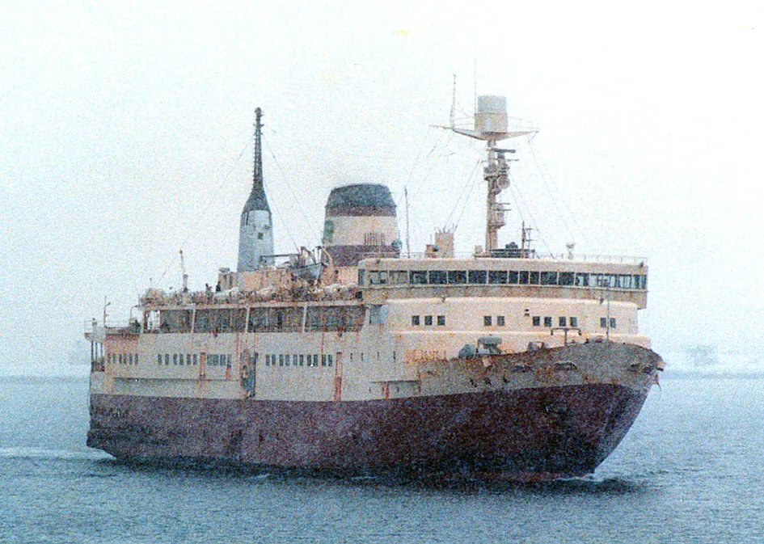
*再現のモデルとなった船*

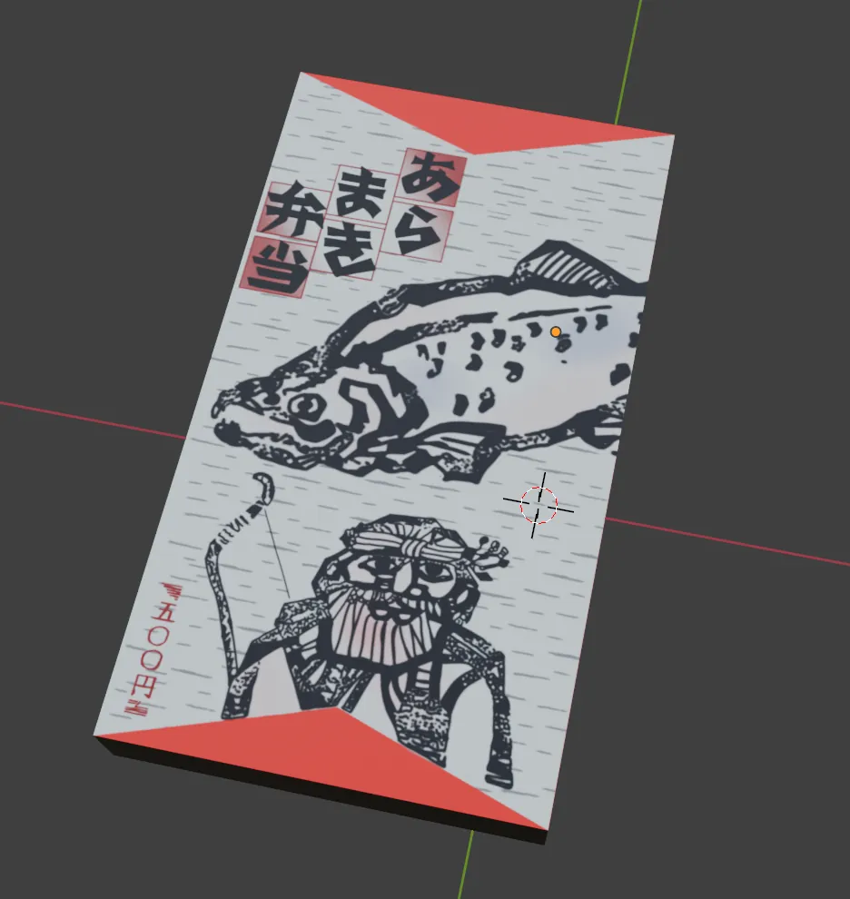 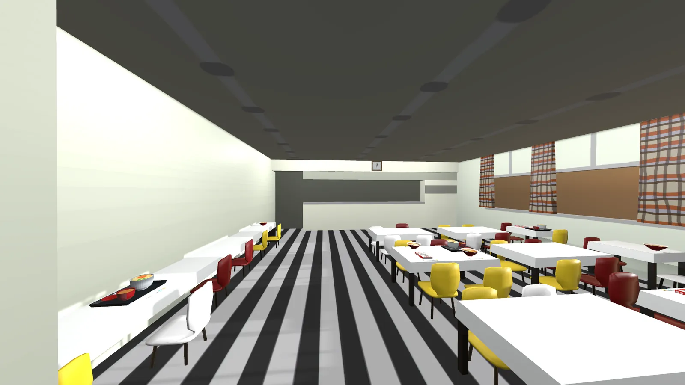
*左：制作中のテクスチャ　右：完成したワールドの船内*

**アブディラー：** 今のワールドは、どのような流れで作られているんですか？

**能代：** 僕は途中から関わったのですが、まず大まかにどんな部屋があるかが決まっていました。僕は船が好きで多少は詳しいものの、海洋学や海洋観測といった専門分野には詳しくないので、一般的なデザインで作れる会議室や机などを担当しています。

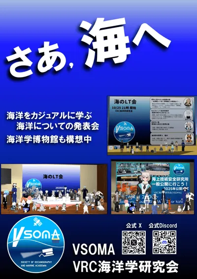 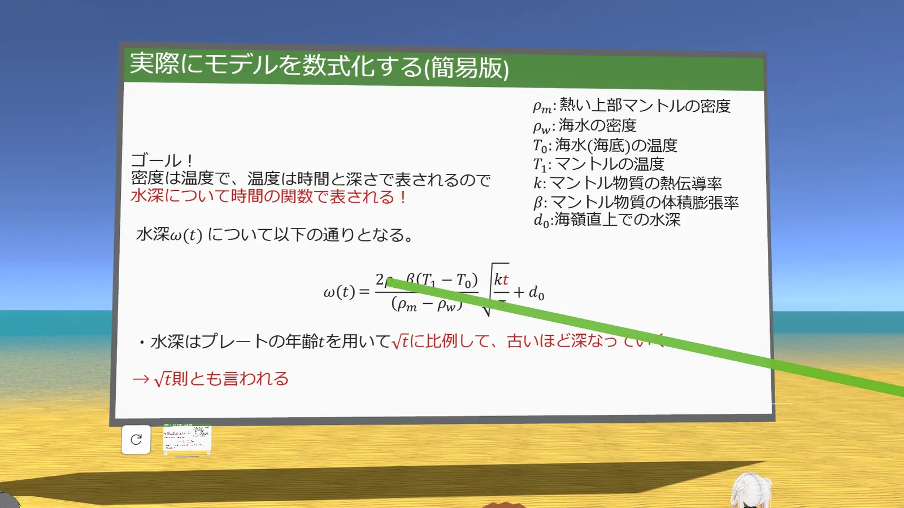
*VRC海洋学研究会（VSOMA）。左：告知ポスター　右：発表会の様子*

**アブディラー：** モデリングにはBlenderを使っているんですか？

**能代：** Blenderです。

**アブディラー：** 単純に気になるんですが、VRChatのワールドはUnityで作られていますよね。チームで共有しながらワールドを作れるものなんですか？

**能代：** 基本的には、各自がBlenderでモデルだけを作って、それをGitHub経由で共有します。最後に主催の方が、自分のUnity上で当たり判定（コライダー）やドアの開け閉めといった仕掛けを追加して、ワールドとして仕上げていく流れです。

> **【注釈】制作に使うツール**
> - **Blender**：無料の3DCG制作ソフト。家具や部屋などの形（モデル）を作る。
> - **Unity**：ゲームエンジン。VRChatのワールドはUnityで組み立てる。
> - **GitHub**：データを複数人で共有・管理するためのサービス。
> - **コライダー**：物体の「当たり判定」。これがないと、壁をすり抜けたり床に立てなかったりする。

**アブディラー：** これまでワールドを作ってきた中で、一番苦労したことは何ですか？

**能代：** 今のところ順調に進んでいるので、大きな苦労は特にありません。ただ、「この部屋をお願い」という何もない状態からのスタートだったので、デザインを決めること、そして現実の船に合わせることとVRらしさとのバランスは、かなり考えて作りました。

**アブディラー：** 実物のものは、どうやってモデリングしているんですか？ 完全に見ながら作る感じですか？

**能代：** 一般公開されている船があるので、そこに行って写真をたくさん撮ってきます。ただ、作っているのは架空の船なので、実物そのままでは寸法が合いません。サイズを調整したり、重くなりすぎないようにテクスチャーで描き込んでそれっぽく見せたり。写真を参考にしつつ、オリジナルのものを作っています。

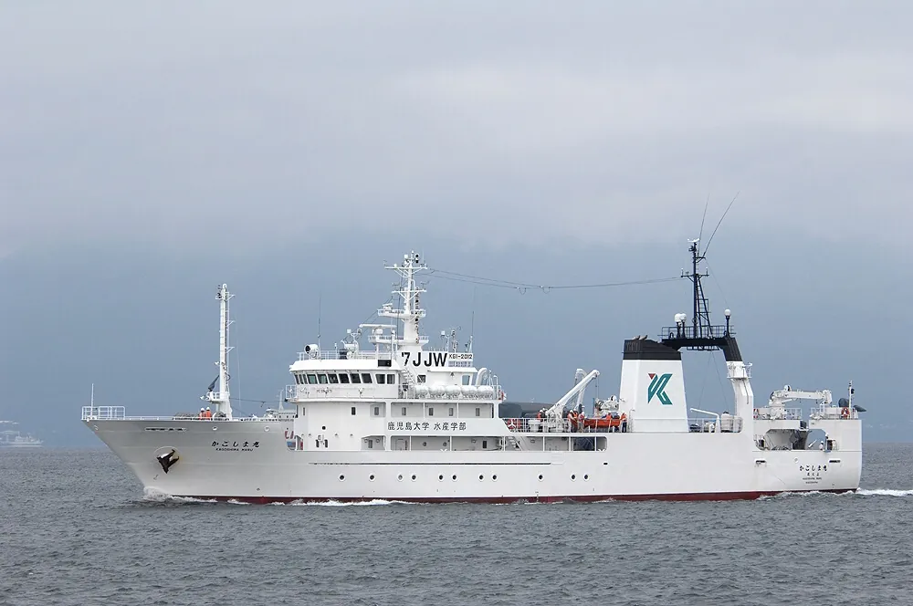 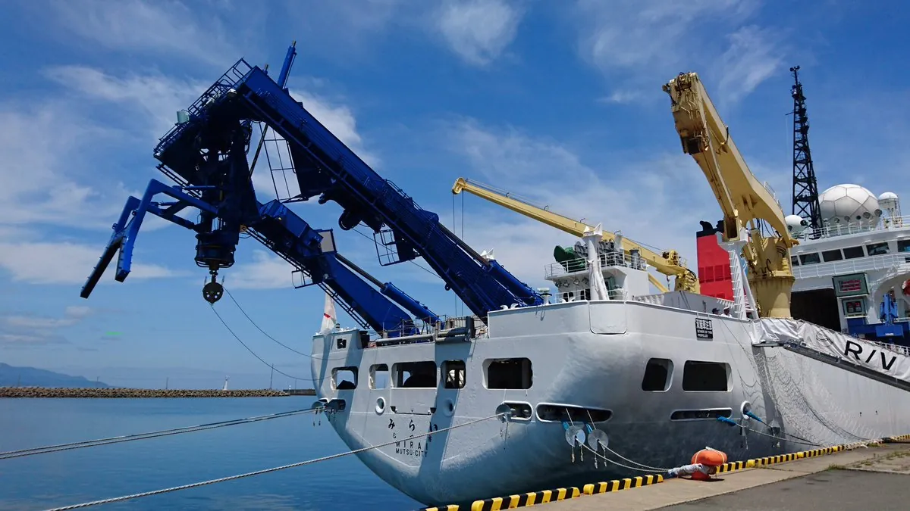
*参考にした実在の船*

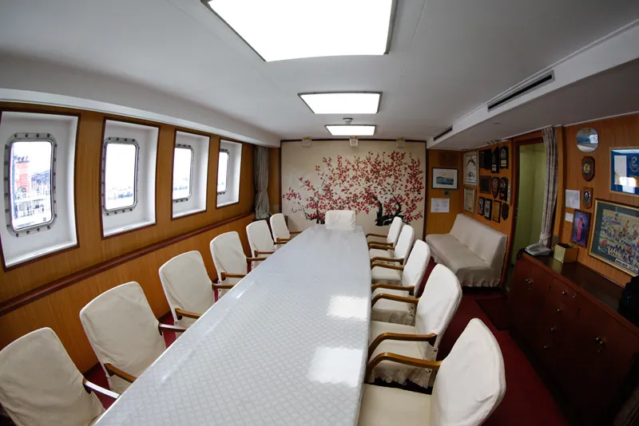
*能代さんが担当した会議室の参考写真*

**アブディラー：** 実際に現地まで足を運んで作っているんですね。その中で、特にこだわった部分はありますか？

**能代：** 図面からは見えてこない部分ですね。実際の船に乗ると、照明のスイッチに「節電しよう」といった小さなテプラが貼ってあったりするんです。完成当時の姿ではなく、船員さんたちが使っていく中で貼り付けたり変えたりしてきたもの。そういうものを実際の船の取材からフィードバックして、リアリティを高める工夫をしました。

> **【引用】**
> 完成当時の姿ではなく、船員さんたちが使っていく中で貼り付けたり変えたりしてきたもの。

---

## ③ 世代を超えたチームづくり

*プロジェクトのメンバーは社会人が中心。学生の能代さんは、その中でどうやって一緒にものを作っているのでしょうか。*

**アブディラー：** 今の企画で一緒に制作している方々は大人ですよね。その方々とはどうやって出会ったんですか？

**能代：** 先ほど話した同人誌のつながりのほか、Twitterや、船の一般公開の際に話したことなどがきっかけです。

**アブディラー：** 年齢や立場が違う人と一緒に作る中で、学んだことはありますか？

**能代：** みんな同じものに熱意を向けているので、意外と年齢は関係ないんです。一方で、学生と社会人ではスケジュールが違うので、そこは難しさを感じました。スケジュール調整は主催の方がやってくださったのですが。

**アブディラー：** 熱意は変わらなくても、大人と学生の間にはどうしても溝が生まれるということですね。

**能代：** そうですね。そこで主催の方が「じゃあここまでやって」と負担をかけすぎないようにしたり、別の人に仕事を回したりと、本当によくやってくださっています。

**アブディラー：** 主催の方がクッションになって、調整してくれているんですね。

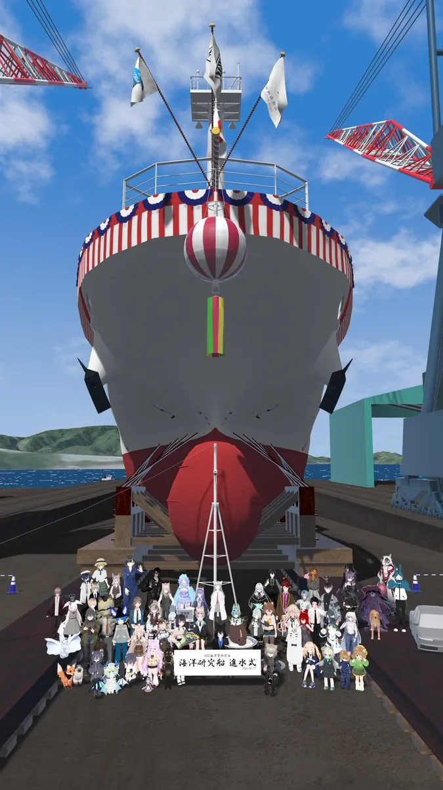
*VRChat内で船の前に集まったメンバーたち*

---

## ④ メタバースは「時間と場所」を超える

*最後に、VRChatとメタバースのこれからについて。能代さんが語る「時間」には、もう一つの意味が込められていました。*

**アブディラー：** 最後に、VRChatとメタバースの未来について語ってもらいたいと思います。まず、今のVRChatの一番の魅力は何だと思いますか？

**能代：** やはり、場所にとらわれないこと。そして「時間」です。これには「時代」という意味も込めています。
実は海洋のほかに、今は宇宙をテーマにした活動もしていて、先日イベントを開催しました。正確には、天文仮想研究所（VSP）という団体の7周年イベントの中の1企画ですが、船の制作で学んだことを活かして、主催を務めました。
そのイベントでは、約40年前に野辺山天文台を設計した方にコンタクトを取りました。世の中に公開されている話の多くは、その施設で研究した天文学者の方の話です。その陰に埋もれてしまっていた、裏方の設計者や技術者の話を皆さんに届けたんです。このように「時代を超える」ことも、メタバースの大きな鍵だと思います。

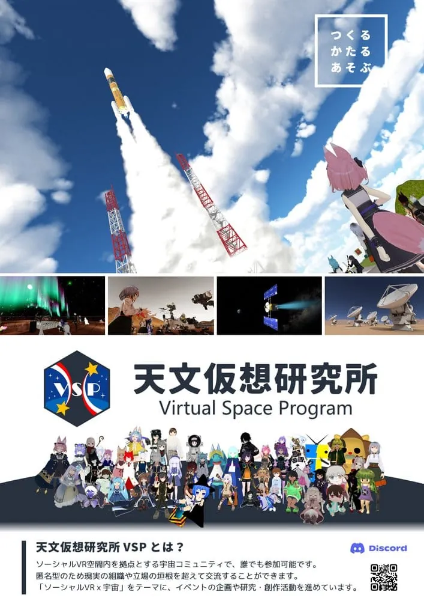 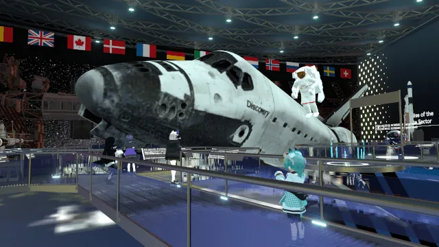
*天文仮想研究所（VSP）。左：ポスター　右：VRChat内の展示*

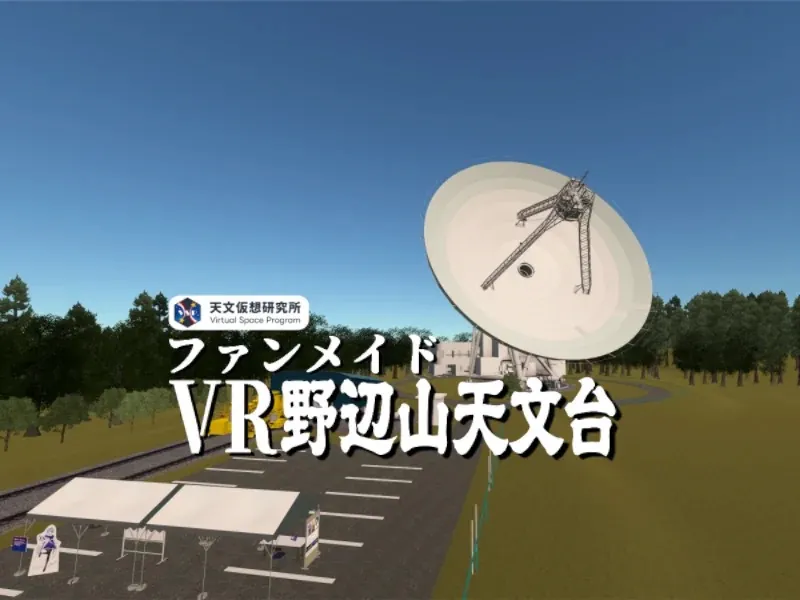 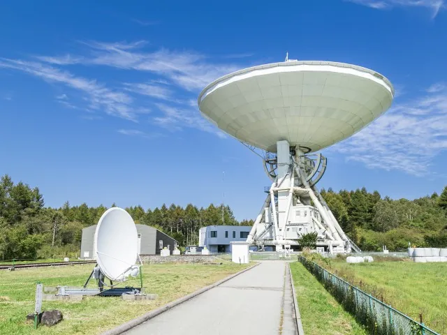
*左：ファンメイドの「VR野辺山天文台」　右：実際の野辺山天文台*

**アブディラー：** 近年、FacebookがMetaに社名を変えてメタバースに力を入れるなど、盛り上がりを感じます。一方で、VRの敷居の高さもあり、メタバースが現実社会に溶け込んでいるとはまだ言えません。5年後、10年後、メタバースはどう変化していくと思いますか？

**能代：** 敷居については、今でもゴーグルなしでデスクトップから参加できます。この裾野の広さが、今後はスマホやスマートウォッチ、ARグラスなどへと広がり、かさばるパソコンを持たなくても参加できるようになっていくと思います。
それと同時に、今のメタバースでは再現できていない匂いや温度などによる没入感も高まっていく。「裾野の広がり」と「没入感の高さ」、この二つの軸でメタバースは発展していくと考えています。

**アブディラー：** メタバースの未来に、課題や不安はありますか？

**能代：** 一番の課題は、メタバースがリアルになっていくほど、できることの限界が問題になることです。たとえば食事。匂いや温度が再現できたとしても、栄養はとれない可能性が高いですよね。メタバースで暮らしている間に、現実の体はどんどん衰弱していく――そんな恐ろしい状況もあり得ると感じています。
食品の3Dプリントなど、技術の発展で克服されていくとは思います。ただ、その過渡期に何が起きるかは分かりません。懸念事項が増えたり、法規制が必要になったりと、さまざまなことが起きるでしょう。

**アブディラー：** お話を聞いていると、能代さんはメタバースを「現実世界の拡張」というより、「もう一つの新しい空間」として捉えているように見えます。

**能代：** 現実世界の拡張としても使えると思います。ただ、もう一つ別の世界があって、そこでは別のアバター、別の体を持てる。現実と切り離すことで、今の人種や容姿の違い、それから資金の差といった現実の格差が一度リセットされるんです。パソコンを買うにはお金が必要ですが、VRChat自体は基本無料ですから。そういう新しい世界は、非常に魅力的だと考えています。

> **【引用】**
> 現実と切り離すことで、今の人種や容姿の違い、それから資金の差といった現実の格差が一度リセットされるんです。

**アブディラー：** これからのメタバースに、能代さんはどんな立場で関わっていきたいですか？

**能代：** メタバースは遊ぶだけでも楽しいですし、それは誰にでもできることです。でも、何かを発信したり、ものを作ってみたりする人が一人でも増えてほしい。
僕がテーマにしている乗り物のように、メタバースという大きなコミュニティの中で何かが発展すれば、もともと興味がなかった人が関心を持つきっかけになります。そこでお金が回ったり、「実物が保存されている場所や博物館に行ってみよう」という動機になったりもする。博物館の資金不足の話もよく聞くので、そうした改善にもつながって、社会がより良くなっていけばいいなと思っています。

**アブディラー：** 以上でインタビューを終わります。ありがとうございました。

**能代：** ありがとうございました。
